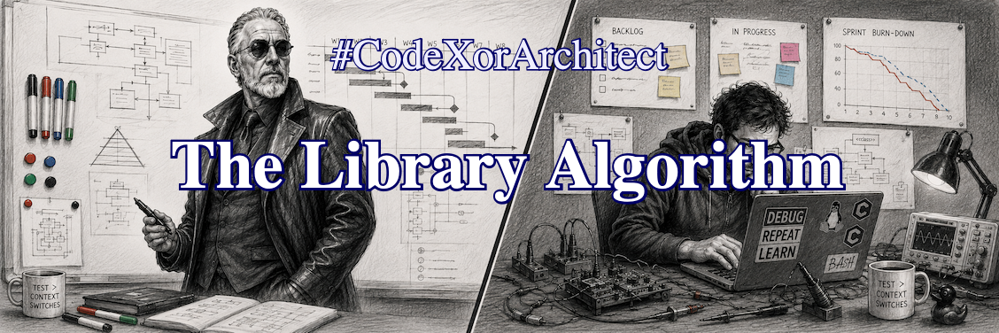

.. Copyright (C) ALbert Mietus, 2026

The Library Algorithm (Scaling Big 2)
=====================================

.. post:: 27/Oct 2026
   :tags: CodeXorArchitect
   :category: LinkedIn-Post

   :reading-time:	1min53
   :LinkedIn: 		https://lnkd.in/p/eXcHXF6H 

   Suppose you want to read a really nice novel --- but which one? Even a modest library or bookshop has more books
   than you can ever read. Maybe you ask yourself about the ‘algorithm’ to find it quickly. But probably not, as
   everybody follows the same approach.

   This 'Library Algorithm', however, can make you a better engineer. And it's *indispensable for a genuine architect*.
   |BR|
   The formula itself is NOT that relevant. What matters is knowing it exists! And that you can use it to mature as an
   engineer.

Architects should make big systems feel simple. When teams are added to speed up development, they quickly need to
understand the system. They need great documentation and need to find the relevant part easily. They shouldn't need to
read everything to discover what they need.
|BR|
For a big system, your library full of code, designs, user manuals, meeting minutes, and more is very much like a
bookshop with novels: too big to read ...
|BR|
When you write, write for an audience; and make sure your readers will find it!

The Library Algorithm isn't about the *best “book”*, nor about searching. Humans start by excluding. When you want a
detective, you skip the science department, you don't enter the 18+ floor, ignore the kids’ corner, and much more. At a
glance, most cabinets are ignored. Humans don’t find; they discard.
|BR|
Eventually, when you find the last few shelves, you turn your head 90 degrees and scan the spines. Again you fly over
most titles; too thin, too thick, or the wrong shade of pink. Finally, you slide a few books forward, actually pick some
up, read the back --- and put them back. Of all those thousands of books, you open maybe a few dozen. Typically to read
the first paragraph only...

Sometimes “the best book” is completely ignored because the bookseller didn't understand it and shelved it wrongly.
|BR|
This doesn't apply only to novelists. The same procedure affects technical documentation, from architecture to code!

Make sure it’s found. Also, your “library shelver” needs your hint on where to place it. Likewise, the title (and the
cover) should be spot-on.
|BR|
Put effort into it so that professionals start reading. And that *'lead'* should seduce your audience to continue reading.

Long story short: Become an architect! Don’t write for people who already know; explain big, complicated systems in a
simple, understandable way. Whether you write a novel, a design, or even code, keep it simple! Simple to find, simple to
read.
|BR|
If you can’t make it simple now, it might be too complicated for you.

#CodeXorArchitect --- Your #TechFluencer

..  LocalWords:  shelver
